# CampusPilot

**Your whole campus in one app: attendance, library seats, print queues, canteen ordering, and an AI planning agent that tells you whether you will make it to class.**

CampusPilot is a serverless web app built on AWS for the **AWS ShipIt Challenge (Techfest IIT Bombay × AWS)**.

- Live demo: `<add your Amplify URL after deploying>`
- Demo video (60–90 s): `<add your video link>`
- AWS Builder Center alias: `<add your alias>`

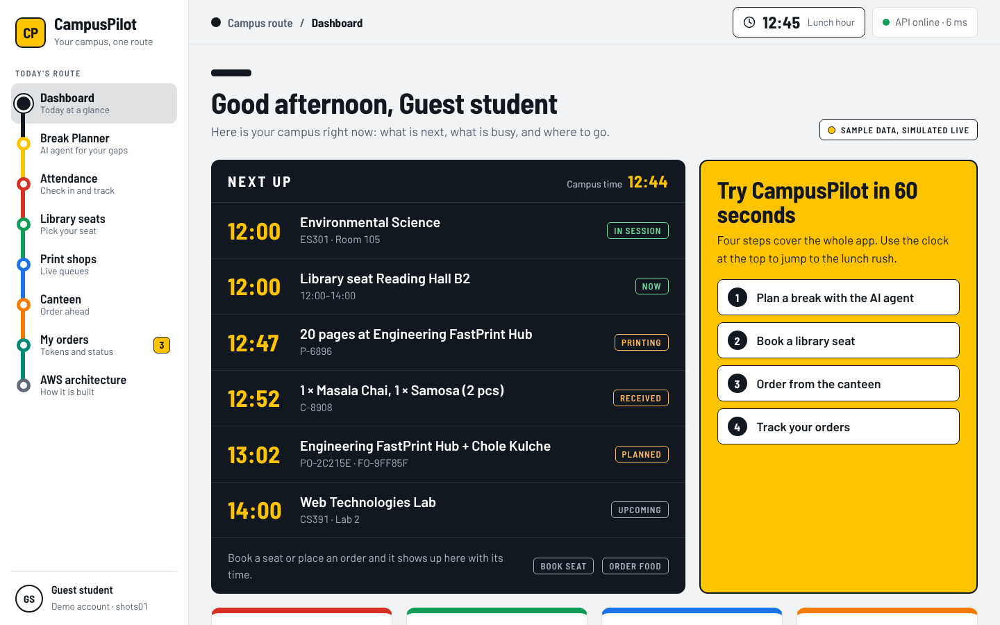

> **Sample data notice.** Print shops, menu, prices, timetable, attendance history, library layout and queue
> lengths are illustrative sample values from a deterministic simulation, not data from any real college.
> Orders and payments are simulated. The AWS services, the data you create (bookings, check-ins, orders)
> and the booking rules are real. Replace the sample values in `backend/src/data.py` and `backend/src/sim.py`
> before presenting this as a real service.

## Design: campus wayfinding

CampusPilot looks like a campus signage and transit system, not a generic dashboard. Your day is a **route**:
the sidebar is a metro-style line with one station per service, each service has its own line colour that
carries through its page, the dashboard centres on a flat **"Next up" departure board**, and orders and library
passes look like **tickets**. The interface is light and flat (no gradients, no glass effects), uses a
signage typeface (Barlow, self-hosted) and a single signal yellow, and works as a drawer-style app on phones.

| Planner (agent trace + route) | Library (BookMyShow-style) | Canteen (cart receipt) |
|---|---|---|
| 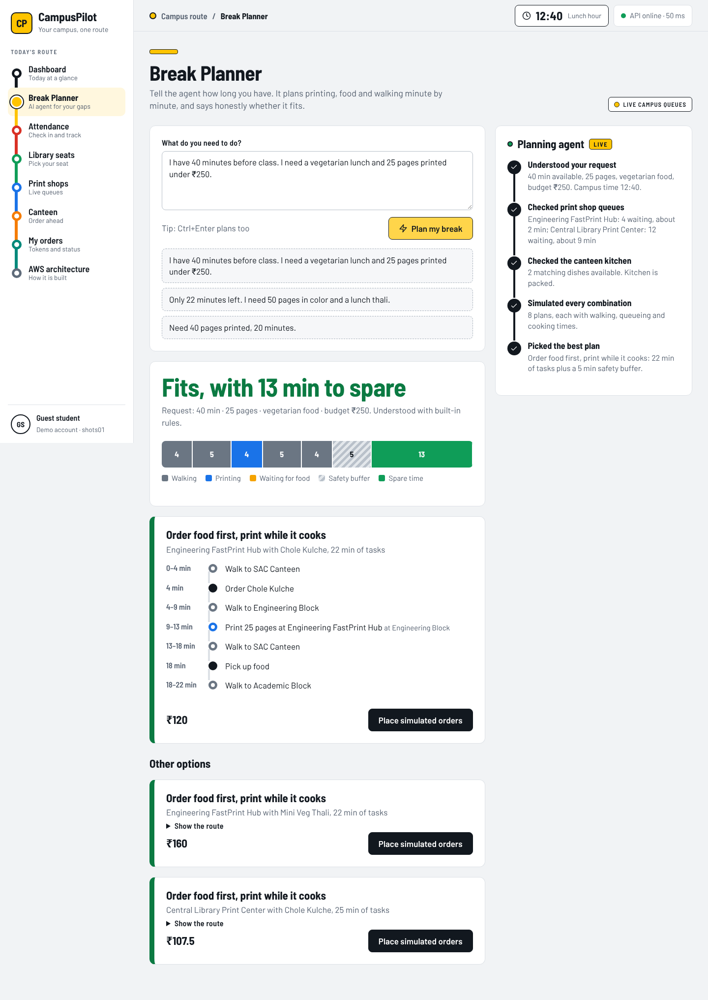 | 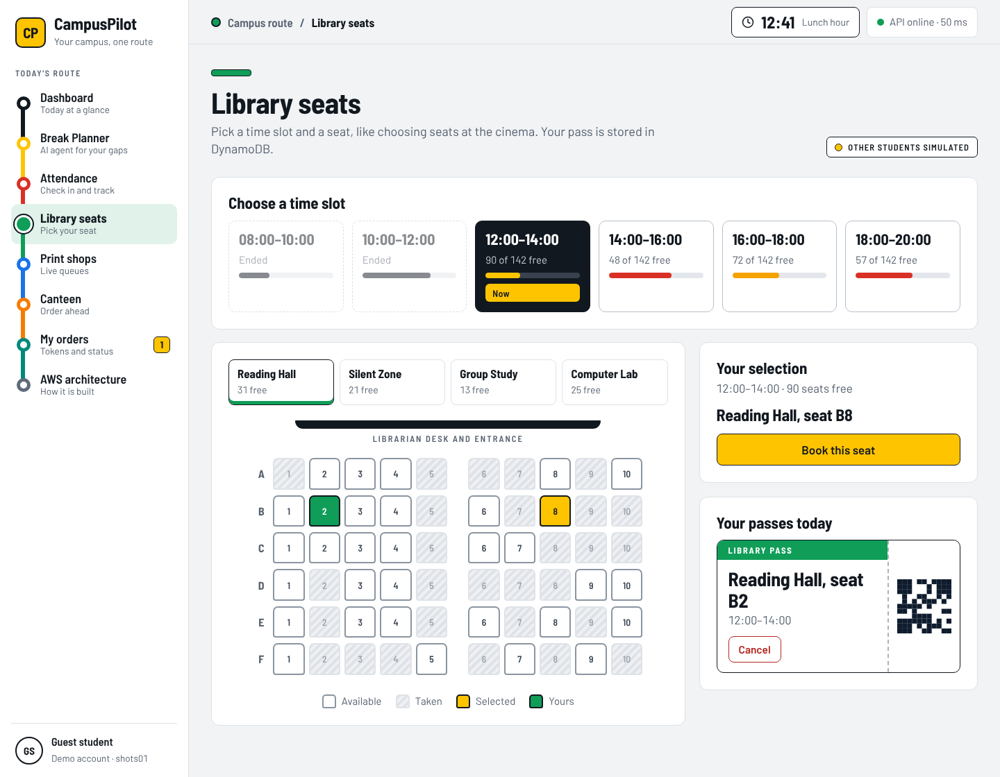 | 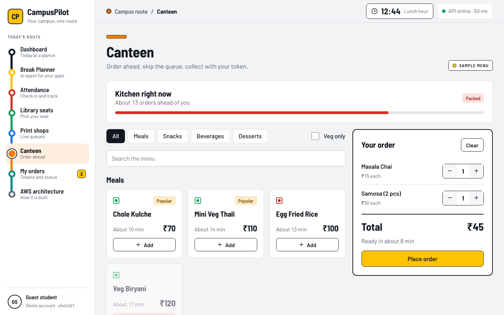 |

| Print shops + agent | Attendance | My orders |
|---|---|---|
| 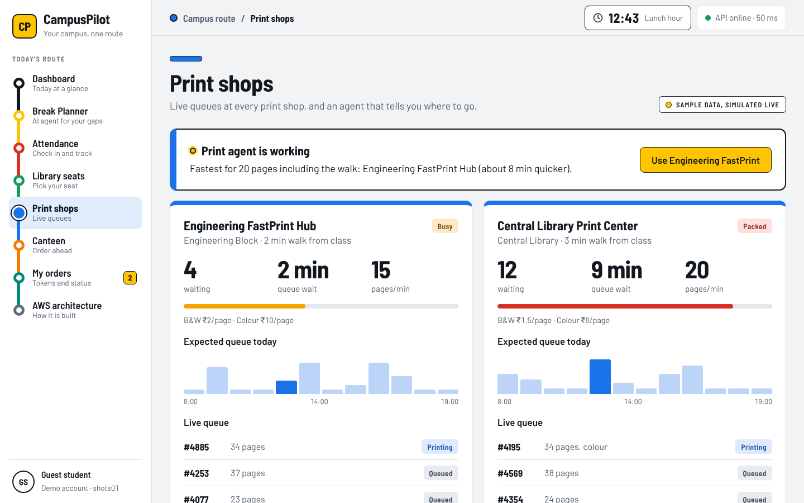 | 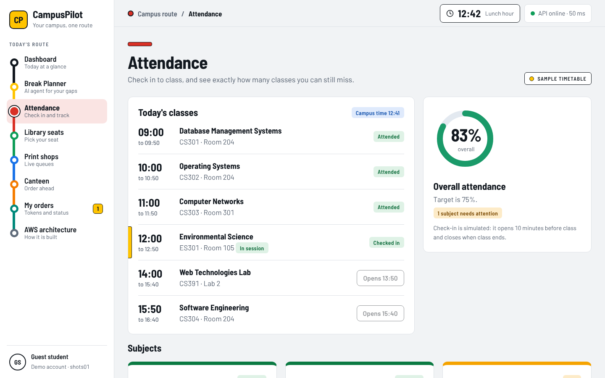 | 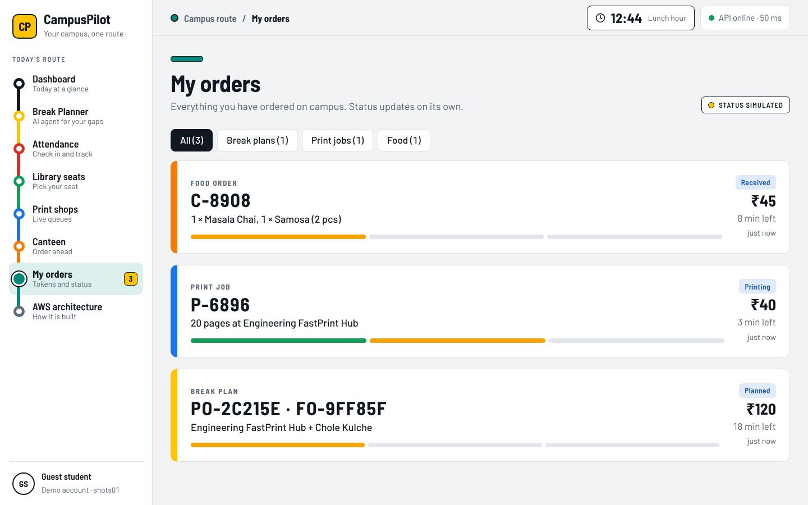 |

| Phone: dashboard | Phone: seat map | Phone: canteen |
|---|---|---|
| 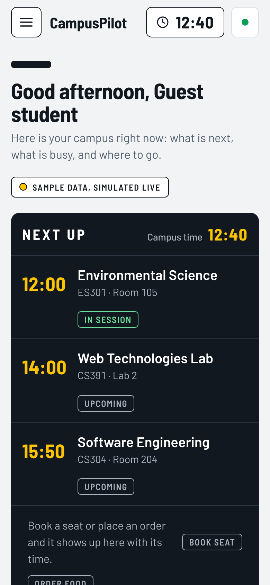 | 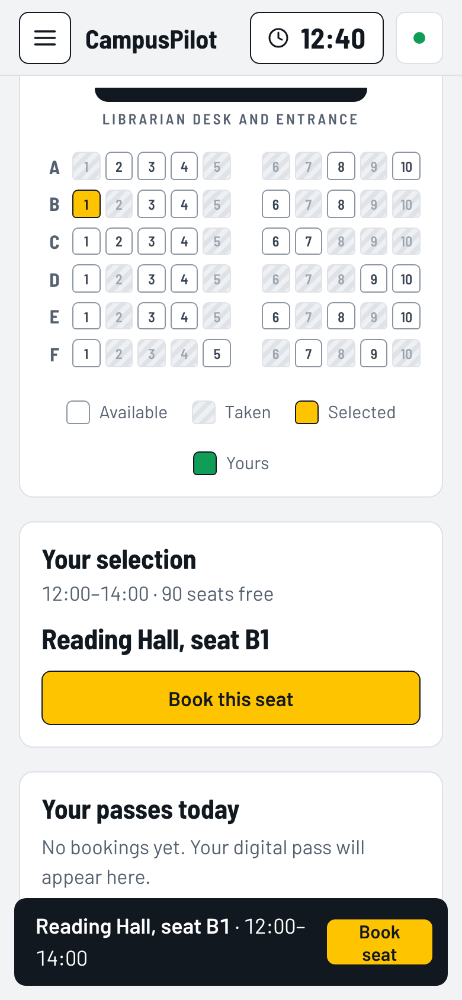 | 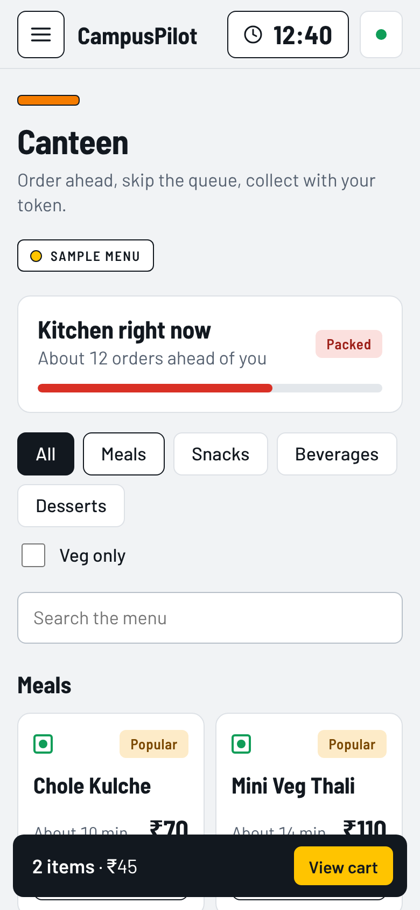 |

*Screenshots are generated from the local app by `scripts/browser.sh shots`, using sample data.*

## The problem

A student's day is full of small, uncertain errands: *Is the library seat I want free? How long is the print
queue? Will the canteen be packed? Can I still skip this class? Will I make it back in time?* Nobody knows, so
students guess, queue, arrive late or skip meals. CampusPilot answers each question with live numbers and
combines them in one place.

## What is inside

| Section | What it does | What is real on AWS |
|---|---|---|
| **Dashboard** | A "Next up" departure board that fills with your classes, seat, print job and food order; a 60-second tour; live stats; an hourly crowd heat strip; agent insights | One aggregated API call over Lambda and DynamoDB |
| **Break Planner** (AI agent) | Type "40 minutes, vegetarian lunch, 25 pages under ₹250". The agent shows its working step by step, compares every shop, dish and task order ("lunch" means a proper meal), and says honestly whether it fits, as a route you can follow | Deterministic planner on Lambda; optional Amazon Bedrock for understanding the sentence |
| **Attendance** | Today's timetable, simulated check-in window, per-subject percentage, "classes you can still miss" calculator | Check-ins stored in DynamoDB with duplicate protection |
| **Library seats** | BookMyShow-style seat picker: time slots, four zones, seat map, digital pass | **Atomic DynamoDB transactions**: two students can never get the same seat, and one seat per slot is enforced |
| **Print shops** | Live queue and rush per shop, expected-queue chart, live job list, an agent that recommends where to print, and a working "send a print job" form | Print jobs stored with idempotency keys |
| **Canteen** | Live kitchen rush, filterable menu, cart, ordering with a pickup token and ETA | Orders validated and priced on the server |
| **My orders** | Break plans, print jobs and food orders in one list with live status | Status derived from stored timestamps, no background servers |
| **AWS architecture** | Diagram, services, a live API and DynamoDB check, and an honest real-versus-simulated table | Live calls to your deployed API |

A **campus clock** in the top bar jumps between Morning rush, Lunch hour, Afternoon and Evening (or real IST
time), so you can see every page react to a busy canteen or a packed print shop at any moment.

## Architecture

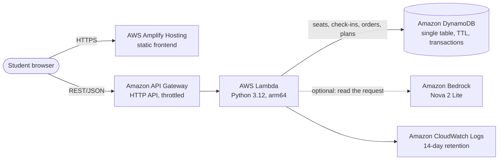

| AWS service | Role in CampusPilot | Cost note |
|---|---|---|
| **Amplify Hosting** | Serves the static frontend over HTTPS (manual zip deployment, no build step) | Usage-based |
| **API Gateway (HTTP API)** | Public REST endpoints, CORS, throttling (10 requests/s, burst 20) | Usage-based |
| **Lambda** | Planner, simulation, booking and order logic | Has an always-free monthly allowance |
| **DynamoDB** | Seats, attendance, orders, plans, campus data (single table, TTL on temporary items) | Provisioned at 10 RCU / 10 WCU, inside the always-free 25 / 25 |
| **Bedrock** *(optional, off by default)* | Understands free-text planner requests | Billed per token; uses your credits when enabled |
| **CloudWatch Logs** | Lambda logs, kept 14 days | Small |

Details (request flow, data model, IAM, design decisions) are in [`docs/ARCHITECTURE.md`](docs/ARCHITECTURE.md).

## Try it locally in two minutes (no AWS account)

```bash
python3 -m venv .venv && source .venv/bin/activate
pip install -r backend/requirements-dev.txt
python backend/dev_server.py          # open http://127.0.0.1:8787
```

This runs the real Lambda code against an in-memory mock of DynamoDB and serves the full app. Data resets when
you stop it.

## Project structure

```
campuspilot-aws/
├── README.md                    Overview, deployment guide, checklist
├── template.yaml                AWS SAM: DynamoDB, HTTP API, Lambda, IAM, log group, outputs
├── LICENSE                      MIT
├── backend/
│   ├── src/                     Deployed to Lambda
│   │   ├── app.py               Handler, route table, validation, all endpoints
│   │   ├── planner.py           Deterministic break-planning engine (pure Python)
│   │   ├── intent.py            Request parser: Bedrock Converse API with rule-based fallback
│   │   ├── sim.py               Deterministic campus simulation: clock, rush, queues, occupancy
│   │   ├── library.py           Seat map and booking rules
│   │   ├── attendance.py        Timetable, check-in window, percentages, skip calculator
│   │   ├── orders.py            Unified order list and simulated live status
│   │   ├── repo.py              DynamoDB access: seeding, TTL checks, conditional writes, transactions
│   │   └── data.py              Sample campus data (shops, menu, timetable, library layout)
│   ├── tests/                   pytest: conftest.py, test_planner.py, test_api.py, test_services.py
│   ├── dev_server.py            Local server: real handler + mocked DynamoDB + the frontend
│   └── requirements-dev.txt     Test and local-dev dependencies (Lambda needs no extra packages)
├── frontend/                    Static site, no build step
│   ├── index.html               App shell: route sidebar, top bar
│   ├── styles.css               Design system (wayfinding look, responsive, desktop sidebar and phone drawer)
│   ├── config.js                API address (deploy.sh writes it into the build copy)
│   ├── fonts/                   Self-hosted Barlow, Barlow Semi Condensed and a rupee-sign subset (OFL licensed)
│   └── js/
│       ├── core.js              DOM helpers, icons, API client, campus clock, toasts
│       ├── main.js              Navigation, router, clock control, API health
│       ├── dashboard.js  planner.js  attendance.js  library.js
│       └── print.js  canteen.js  orders.js  architecture.js
├── tests/e2e/
│   ├── ui_flow.mjs              UI flow test (Node + jsdom) against the dev server
│   └── browser_flows.py         Real-browser flow and layout test (Playwright + Chromium), optional
├── scripts/
│   ├── deploy.sh                SAM deploy, API + seat-booking smoke test, Amplify deploy (with security headers), live check
│   ├── destroy.sh               Removes everything (asks for confirmation)
│   ├── validate.sh              Runs every local check
│   ├── e2e.sh                   Starts the dev server, runs the jsdom UI flow test, stops it
│   ├── browser.sh               Starts the dev server and runs the real-browser test or regenerates screenshots
│   └── screenshots.py           Generates docs/screenshots/*.png
├── .github/workflows/ci.yml     CI: tests, lint, UI flow test and the real-browser test
└── docs/
    ├── screenshots/             README images
    ├── ARCHITECTURE.md          Request flow, data model, IAM, design decisions
    ├── TESTING.md               Automated results and the manual browser test plan
    ├── AUDIT.md                 Findings, fixes, and what is and is not verified
    └── DEMO_SCRIPT.md           90-second demo script and submission checklist
```

## API

All endpoints accept an optional `at=HH:MM` (campus time) so the demo can jump to busy moments. Ids are
anonymous per-browser ids. Errors are JSON `{"error": "..."}` with 400, 404, 409, 422 or 500.

| Method and path | Purpose |
|---|---|
| `GET /health` | Health check |
| `GET /campus` | Print shops and menu with live queue and prep times |
| `POST /plan` | `{"text"}` → verdict, best plan, alternatives and the agent trace |
| `POST /orders` | `{"plan_id","student_id"}` → places simulated orders for a feasible plan |
| `GET /orders?student_id=` | All the student's orders with live status |
| `GET /dashboard?student_id=` | Aggregated overview for the dashboard |
| `GET /attendance?student_id=` | Today's classes, subject percentages, skip calculator |
| `POST /attendance/checkin` | `{"period_id"}` → check in (only inside the check-in window) |
| `GET /library?student_id=&slot=` | Slots, zones and seat map |
| `POST /library/book` | `{"slot","seat"}` → atomic booking (409 if taken or already booked in that slot) |
| `POST /library/cancel` | `{"slot"}` → cancels the student's booking |
| `GET /print?student_id=` | Shops with queue, forecast and jobs, plus the agent's advice and activity |
| `POST /print/jobs` | `{"shop_id","pages","color","request_id"}` → submits a print job (idempotent) |
| `GET /canteen` | Menu with live prep times and kitchen rush |
| `POST /canteen/orders` | `{"items":[{"id","qty"}],"request_id"}` → places a food order (idempotent) |

## Deploy to your AWS account

### Prerequisites

- An AWS account and an IAM identity that can create CloudFormation, Lambda, API Gateway, DynamoDB, IAM
  roles, CloudWatch Logs, S3 (for SAM artifacts) and Amplify resources.
- [AWS CLI](https://aws.amazon.com/cli/) configured (`aws configure`), [AWS SAM CLI](https://docs.aws.amazon.com/serverless-application-model/latest/developerguide/install-sam-cli.html), `zip` and `curl`.
- **Set a billing alert first** in AWS Budgets (console). See "Cost and account notes".

### Deploy

```bash
./scripts/validate.sh              # optional: run all local checks first
./scripts/deploy.sh                # region defaults to ap-south-1 (Mumbai)
```

The script checks your tools and credentials, deploys the backend, then **smoke-tests the live API**: it runs
a plan and books and cancels a library seat, which proves API Gateway, Lambda, IAM and DynamoDB transactions
work together. It then builds the frontend with your API address, uploads it to Amplify Hosting, waits for the
deployment, and prints your live URL. If a step fails it stops with a plain-language message. Options:

```bash
AWS_REGION=ap-south-2 ./scripts/deploy.sh      # another region
USE_BEDROCK=true ./scripts/deploy.sh           # enable Amazon Bedrock (optional, billed per token)
./scripts/destroy.sh                           # delete everything when you are finished
```

Campus data seeds itself into DynamoDB on the first request. After editing `backend/src/data.py`, run
`./scripts/deploy.sh` again: the change is detected and the table re-seeds on the next request.

### Enabling Amazon Bedrock (optional)

Bedrock is **off by default** so the app costs nothing extra. With `USE_BEDROCK=true` the planner calls the
Bedrock Converse API (default model `global.amazon.nova-2-lite-v1:0`, changeable with the `BedrockModelId`
parameter). Confirm in the Bedrock console that the model is available in your region and account. If the call
fails or times out (8 s), the planner falls back to the built-in parser, so the demo never breaks. The
planner shows which parser read each request ("Understood with Amazon Bedrock" or "built-in rules").

## Cost and account notes

- Accounts created on or after 15 July 2025 start on a **Free plan** with up to $200 in credits (including
  $100 you can earn by trying services) for up to 6 months or until credits run out, and some services are
  restricted on that plan. Older accounts use the earlier Free Tier rules. Check your own account on the
  Billing console's Credits page and at <https://aws.amazon.com/free/>.
- A Free plan account closes when the plan ends. Keep your stack running until the challenge results are
  announced, then run `./scripts/destroy.sh`.
- Safeguards built in: API throttling, 14-day log retention, DynamoDB at 10/10 provisioned capacity, TTL on
  plans, bookings, check-ins and orders, Bedrock disabled by default.
- AWS Budgets alerts are account-level and not created by this project. Create one in the console.

## Run the tests

```bash
./scripts/validate.sh        # 46 backend tests, template lint, script and JS syntax, 60 UI flow checks
```

The UI flow test needs Node 18+ (`./scripts/e2e.sh` installs jsdom on first run). An optional real-browser
test (`pip install -r tests/e2e/requirements.txt && playwright install chromium`, then
`./scripts/browser.sh test`) drives the app in Chromium and checks layout. Details and the manual device test
plan are in [`docs/TESTING.md`](docs/TESTING.md).

## How it works

**Planner.** For every combination of print shop and available dish (respecting vegetarian and budget
filters), the planner simulates both task orders on a clock: walking times, print time as
`queue + ceil(pages / pages-per-minute)`, food wait as `max(0, ready time − arrival time)`. A plan is
feasible when `minutes available − total time − safety buffer ≥ 0` and the cost is within budget. If nothing
fits, it tries dropping one task and offers that as an alternative. The "agent trace" shown in the UI is built
from the real numbers the planner used (queue lengths, dishes considered, plans simulated).

**Simulation.** `sim.py` turns a campus time into rush levels, queue lengths, kitchen prep delays and
library occupancy using smooth daily curves and stable hashing, so the same time always gives the same numbers
and every page agrees with every other page. The planner uses the same live queues you see on the Print page.

**Seat booking.** A booking writes two DynamoDB items in one transaction: the seat (`SEAT#<date>`, condition
"must not exist") and the student's slot allowance (`MYSEAT#<student>`, same condition). Either both succeed
or neither does, which is what prevents double booking under concurrent requests.

## Security

- **Least-privilege IAM.** The Lambda can call six DynamoDB actions on its own table only (the same actions
  AWS documents for transactions). Bedrock access exists only when enabled, limited to Bedrock ARNs.
- **Input validation.** Sizes, types, id formats, time format and numeric ranges are checked on every route;
  malformed input returns 400, never a stack trace.
- **Server-side integrity.** Prices, availability and plan feasibility are re-checked on the server; orders use
  idempotency keys or conditional writes; plans expire after one hour, enforced in code.
- **No HTML injection.** The frontend never writes HTML strings (verified by a test).
- **Strict Content-Security-Policy.** The app loads nothing from other hosts (fonts are self-hosted) and uses no
  inline scripts or styles, so the policy is `default-src 'self'` plus your API address only. `deploy.sh`
  applies it through Amplify headers, together with `X-Content-Type-Options`, `X-Frame-Options`,
  `Referrer-Policy`, `Permissions-Policy` and HSTS. The same policy runs in the local dev server, where a test in
  real Chromium confirmed that injected inline script and style are blocked while the app itself triggers no
  violations. Applying the headers on Amplify itself is not verified from here.
- **Known limits.** No sign-in: each browser gets an anonymous random id, and anyone who knows an id could
  list that id's (simulated) data. CORS allows any origin because no cookies or credentials are used.

## Honest limitations

- Orders and payments are **simulated**; nothing is sent to a real print shop or canteen.
- Queue lengths, rush levels, other students' seats, the timetable and attendance history are generated by a
  simulation. Check-in does not verify a real location.
- The app is tested in code, in jsdom and in real Chromium (desktop and phone-sized viewports, with screenshots
  reviewed), but **not yet on real phones, Safari or Firefox, or on a live AWS account** by the author of this repo.
  See [`docs/AUDIT.md`](docs/AUDIT.md) for exactly what was and was not verified.

## Troubleshooting

| Symptom | Likely cause and fix |
|---|---|
| `deploy.sh`: "AWS credentials are missing" | Run `aws configure` (or `aws sso login`) |
| "API smoke test failed" or "booking a seat failed" | Run the `aws logs tail ...` command printed in the error; usually IAM, region or a service restricted on your plan |
| Amplify error on `list-apps` / `create-app` | Your IAM user needs Amplify permissions, or Amplify is unavailable in that region or on your plan |
| Top bar says "API not configured" | The site was not deployed through `deploy.sh`; redeploy, or use `backend/dev_server.py` locally |
| Top bar says "API unreachable" | Check the API URL and that the stack still exists |
| Planner says "built-in rules" after enabling Bedrock | The Bedrock call failed (model access or region). Check the Lambda logs |
| Seat map or queues look different at different times | By design: use the campus clock in the top bar to pick a moment |

## Roadmap

- Amazon Cognito sign-in with college email and per-user data ownership
- Live queue lengths reported by shop staff through a small admin page
- Amazon EventBridge + SNS to notify when food is ready or a seat slot is about to start
- Real timetable import and QR or Wi-Fi based attendance
- Content-Security-Policy and a custom domain

## AWS ShipIt Challenge checklist

- [ ] AWS Builder Center profile created and alias claimed
- [ ] Student verification completed through SheerID
- [ ] `./scripts/deploy.sh` finished and printed your live URL
- [ ] Live link opened in an incognito window, on a phone and on a laptop (see `docs/TESTING.md`)
- [ ] README screenshots checked (they come from the local app; retake them from your live site if you prefer)
- [ ] README placeholders at the top replaced (live URL, video link, alias)
- [ ] 60–90 second demo video recorded (see `docs/DEMO_SCRIPT.md`) and linked
- [ ] Submitted at <https://techfest.org/aws-shipit-challenge> before **27 November 2026**
- [ ] Screenshot of the submission confirmation saved as proof
- [ ] Stack kept running until results are announced, then `./scripts/destroy.sh`

## License and credits

MIT. See [`LICENSE`](LICENSE). Fonts: Barlow and Barlow Semi Condensed (SIL Open Font License) and a one-glyph
subset of Noto Sans for the rupee sign (SIL Open Font License), all self-hosted in `frontend/fonts/`.
# CampusPilot-aws

